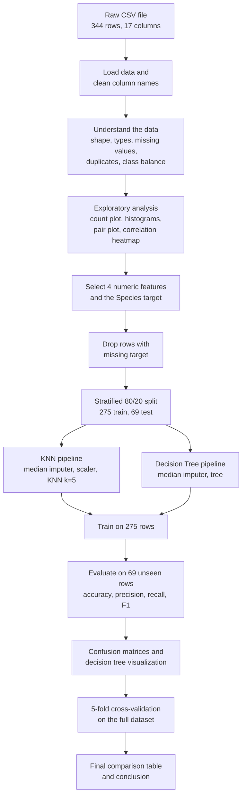

# Penguin Species Classification

Can you tell what kind of penguin you are looking at just by measuring its beak, flipper and weight? That was the question behind this project. We took the Palmer Penguins dataset and built two machine learning models, K-Nearest Neighbors (KNN) and a Decision Tree, to predict whether a penguin is an Adelie, a Chinstrap or a Gentoo.


---

## Table of Contents

1. [Project at a glance](#project-at-a-glance)
2. [The pipeline](#the-pipeline)
3. [About the dataset](#about-the-dataset)
4. [Step-by-step walkthrough](#step-by-step-walkthrough)
5. [Results](#results)
6. [What I learned](#what-i-learned)
7. [Limitations and honest caveats](#limitations-and-honest-caveats)
8. [Ideas for future work](#ideas-for-future-work)
9. [Project structure](#project-structure)
10. [How to run this project](#how-to-run-this-project)
11. [Tech stack](#tech-stack)
12. [Acknowledgements](#acknowledgements)
13. [Author](#author)
14. [License](#license)

---

## Project at a glance

| Item | Details |
|------|---------|
| Goal | Predict penguin species from physical measurements |
| Problem type | Multi-class classification (3 classes) |
| Dataset | Palmer Penguins (`data/penguins_lter.csv`), 344 records, 17 columns |
| Input features | Culmen Length, Culmen Depth, Flipper Length, Body Mass |
| Target | Species (Adelie, Chinstrap, Gentoo) |
| Models | K-Nearest Neighbors (k = 5) and Decision Tree |
| Best model | KNN, with 100% test accuracy and 98.55% cross-validated accuracy |

---

## The pipeline

Here is the full journey of the data, from the raw CSV file to the final conclusion.



If the diagram does not render in your viewer, here is the same flow in plain text:

```
Raw CSV
  -> Load and clean column names
  -> Understand the data (shape, types, missing values, duplicates, class balance)
  -> Exploratory data analysis (plots)
  -> Choose features and target
  -> Remove rows with a missing target
  -> Stratified 80/20 train-test split
  -> Build two pipelines (KNN and Decision Tree)
  -> Train both models
  -> Evaluate on the test set
  -> Confusion matrices and tree visualization
  -> 5-fold cross-validation
  -> Final comparison and conclusion
```

---

## About the dataset

The data comes from the Palmer Station Long Term Ecological Research (LTER) program in Antarctica. It records measurements for three penguin species living on islands in the Palmer Archipelago.

**Class counts in the full dataset**

| Species | Count |
|---------|-------|
| Adelie (Pygoscelis adeliae) | 152 |
| Gentoo (Pygoscelis papua) | 124 |
| Chinstrap (Pygoscelis antarctica) | 68 |

**The four features I used**

| Feature | What it measures |
|---------|------------------|
| Culmen Length (mm) | Length of the upper ridge of the bill |
| Culmen Depth (mm) | How deep the bill is, top to bottom |
| Flipper Length (mm) | Length of the flipper |
| Body Mass (g) | Weight of the penguin |

**Missing values worth knowing about**

| Column | Missing entries |
|--------|-----------------|
| Culmen Length, Culmen Depth, Flipper Length, Body Mass | 2 each |
| Sex | 10 |
| Delta 15 N and Delta 13 C (isotope readings) | 14 and 13 |
| Comments | 318 |

There were no duplicate rows.

---

## Step-by-step walkthrough

### Step 1: Import libraries and load the data

I started by importing the tools I needed: pandas and NumPy for data handling, Matplotlib and Seaborn for plots, and scikit-learn for modeling and evaluation. Then I loaded `penguins_lter.csv` into a DataFrame and stripped any stray spaces from the column names, because hidden whitespace in column names is the kind of small thing that causes confusing errors later.

The dataset has 344 rows and 17 columns.

### Step 2: Understand the dataset


- **Shape and data types.** 344 rows, 17 columns, a mix of text and numbers.
- **Missing values.** Only a handful of rows were missing measurements, which is manageable.
- **Statistical summary.** For example, body mass ranges from 2,700 g to 6,300 g, and flipper length from 172 mm to 231 mm. The fact that the features sit on very different scales mattered later, when I chose to scale the data for KNN.
- **Duplicates.** None found.
- **Class balance.** Adelie is the largest group and Chinstrap the smallest, so the classes are somewhat imbalanced. That influenced how I split the data.

### Step 3: Exploratory data analysis (EDA)


1. **Species count plot.** Shows the class imbalance at a glance.
2. **Feature histograms by species.** One plot per feature, with a density curve for each species. This is where it becomes clear that the species overlap in some measurements but separate nicely in others. Gentoo penguins, for instance, tend to be heavier with longer flippers.
3. **Pair plot.** Every feature plotted against every other feature, coloured by species. The clusters in this plot were the first real hint that a simple model could do well.
4. **Correlation heatmap.** Shows how strongly the four features move together. Flipper length and body mass, for example, are strongly related.

### Step 4: Preprocessing


1. **Chose features and target.** The four numeric measurements became `X`, and Species became `y`.
2. **Removed rows with a missing target.** A row with no species label cannot teach or test a classifier. (In this dataset every row had a species, so no rows were lost, but the check keeps the code safe for other data.)
3. **Split into training and test sets.** I used an 80/20 split with `random_state=42` so the results are reproducible. This gave 275 training rows and 69 test rows.
4. **Used stratification.** Because the classes are imbalanced, I stratified the split so each set keeps the same species proportions as the original data:

| Species | Train | Test |
|---------|-------|------|
| Adelie | 122 | 30 |
| Gentoo | 99 | 25 |
| Chinstrap | 54 | 14 |


### Step 5: Model building and training

 built two models, each wrapped in a scikit-learn `Pipeline` so that preprocessing and prediction always happen together.

**Model 1: K-Nearest Neighbors**

1. Fill missing values with the **median** (robust to outliers).
2. **Standardize** the features with `StandardScaler`. KNN works by measuring distances, so a feature like body mass (in the thousands) would otherwise overwhelm culmen depth (in the teens).
3. Classify using the **5 nearest neighbors**.

**Model 2: Decision Tree**

1. Fill missing values with the **median**.
2. Train a `DecisionTreeClassifier` (`random_state=42`).

 skipped scaling for the tree because trees split on thresholds and do not care about feature scale.

### Step 6: Model evaluation

tested both models on the 69 rows they had never seen. For each one calculated accuracy, weighted precision, weighted recall and weighted F1-score, and printed a full per-species classification report. used weighted averages so that the larger classes count proportionally more, which suits an imbalanced dataset.

### Step 7: Comparing the models

Put both sets of scores into a single table and drew a bar chart so the difference was easy to see. The notebook then picks the best model automatically using the highest weighted F1-score.

### Step 8: Confusion matrices and the decision tree

Accuracy alone does not tell you where a model goes wrong, so plotted confusion matrices for both models side by side. They show exactly which species get mixed up with which.

also plotted the trained Decision Tree itself. This is one of the nicest things about trees: you can read the actual rules the model learned, such as which measurement it checks first and what threshold it uses.

### Step 9: Cross-validation and final comparison

A single train-test split can be lucky or unlucky, especially with only 69 test rows. To get a steadier estimate ran **5-fold cross-validation** on the full dataset for both models. Because imputation and scaling sit inside the pipelines, they are re-fitted inside every fold, so there is no leakage.

Finally, merged the test-set metrics and the cross-validation results into one final table and printed the conclusion.

---

## Results

**Test set performance (69 unseen penguins)**

| Model | Accuracy | Precision | Recall | F1 Score |
|-------|:--------:|:---------:|:------:|:--------:|
| KNN | 1.0000 | 1.0000 | 1.0000 | 1.0000 |
| Decision Tree | 0.9855 | 0.9861 | 0.9855 | 0.9855 |

**5-fold cross-validation (full dataset)**

| Model | Fold scores | Mean accuracy | Std deviation |
|-------|-------------|:-------------:|:-------------:|
| KNN | 0.9710, 0.9855, 0.9855, 1.0000, 0.9853 | 0.9855 | 0.0092 |
| Decision Tree | 0.9565, 0.9855, 0.9565, 0.9855, 0.9265 | 0.9621 | 0.0220 |

**Per-species behaviour on the test set**

- KNN classified all 69 penguins correctly.
- The Decision Tree made a single mistake: one Adelie penguin was predicted as a Gentoo. Everything else was correct.

**Conclusion:** KNN is the better model here. It scored higher on the test set, higher in cross-validation, and was more consistent from fold to fold (a standard deviation of 0.0092 versus 0.0220 for the tree).

---

## What We learned

- **Measurements really do separate these species.** Even with only four numeric features, both models classify penguins very accurately.
- **Scaling matters for KNN.** Features measured in grams and features measured in millimetres cannot be compared fairly without standardizing them first.
- **Pipelines keep you honest.** Putting imputation and scaling inside the pipeline prevents data leakage, both in the train-test split and in cross-validation.
- **One split is not the whole story.** The test accuracy of 100% looks impressive, but the cross-validated figure of 98.55% is the more realistic number to quote.
- **Decision Trees are easy to explain.** Even though KNN won on accuracy, the tree offers something KNN cannot: a set of readable rules.

---

## Limitations and honest caveats

- **Small test set.** With only 69 test samples, a perfect score is encouraging but not proof that the model will be flawless on new data.
- **Small dataset overall.** 344 penguins is enough for a learning project, but not for strong claims about generalization.
- **Default settings.** used k = 5 for KNN and the default tree settings. did not tune hyperparameters.
- **Features only.** used four numeric measurements. Island, sex and the isotope readings were left out.
- **Possible overfitting in the tree.** The tree is unpruned, which likely explains its higher variance across folds.

---

## Ideas for future work

- Tune hyperparameters with `GridSearchCV` (for example, different values of k, tree depth and minimum samples per leaf).
- Add more models such as Random Forest, Logistic Regression and SVM for comparison.
- Try adding Island and Sex as features, using one-hot encoding.
- Look at feature importance to see which measurement matters most.
- Save the best model with `joblib` and wrap it in a small web app where you type in measurements and get a species prediction.

---

## Project structure

```
penguin_classification/
├── data/
│   └── penguins_lter.csv           # Raw dataset
├── Penguin_Classification.ipynb    # Full analysis and modeling notebook
├── requirements.txt                # Python dependencies
├── .gitignore                      # Files Git should ignore
├── LICENSE                         # MIT License
└── README.md                       # You are here
```

---

## How to run this project

**1. Clone the repository**

```bash
git clone https://github.com/ashk-k10/penguin_classification.git
cd penguin_classification
```

**2. (Optional) Create a virtual environment**

```bash
python -m venv venv

# macOS / Linux
source venv/bin/activate

# Windows
venv\Scripts\activate
```

**3. Install the dependencies**

```bash
pip install -r requirements.txt
```

**4. Launch Jupyter Notebook**

```bash
jupyter notebook
```

**5. Run the analysis**

Open `Penguin_Classification.ipynb` and choose **Kernel > Restart & Run All**. Make sure you start Jupyter from the project's main folder so the notebook can find `data/penguins_lter.csv`.

---

## Tech stack

- Python 3.10+
- pandas and NumPy for data handling
- Matplotlib and Seaborn for visualization
- scikit-learn for modeling, pipelines and evaluation
- Jupyter Notebook for the interactive workflow

---

## Acknowledgements

The data were collected and made available by Dr. Kristen Gorman and the Palmer Station Long Term Ecological Research (LTER) Program, part of the US Long Term Ecological Research Network. Thank you to them for sharing such a well-documented dataset.

---

## Author

**ashk-k10**
GitHub: [@ashk-k10](https://github.com/ashk-k10)
GitHub: [@

If you have feedback or ideas for improving this project, feel free to open an issue or reach out.

---

## License

This project is released under the MIT License. See the [LICENSE](LICENSE) file for details.
